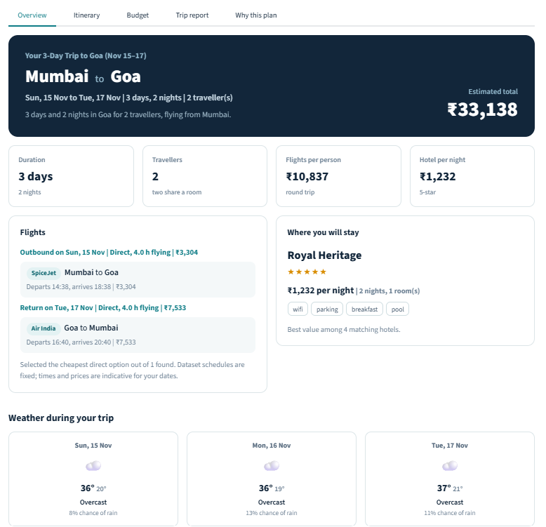
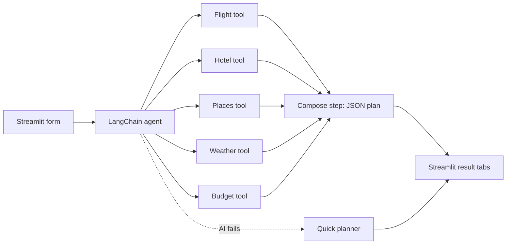
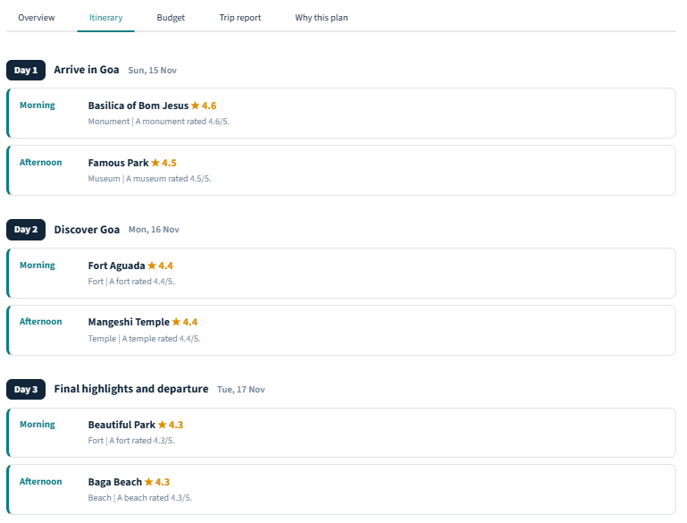
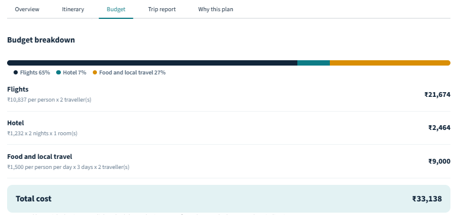
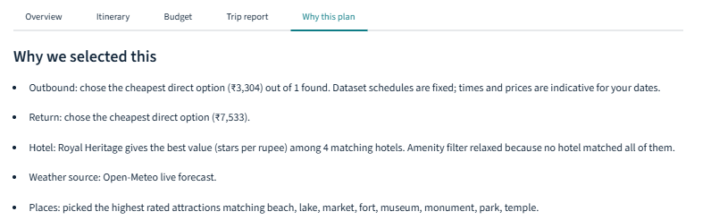

# Wayfinder: Agentic AI Travel Planner

An AI travel agent built with **LangChain** and **Streamlit**. Tell it where you want to go, and it searches
flights, picks a hotel, checks the weather, builds a day-wise itinerary, estimates the budget and explains why it
chose each option.

**Live demo:** `https://YOUR-APP-NAME.streamlit.app` &nbsp;|&nbsp; **Author:** Nandini 



---

## Table of contents

1. [Problem and use case](#1-problem-and-use-case)
2. [Objectives](#2-objectives)
3. [Features](#3-features)
4. [How it works](#4-how-it-works)
5. [Tech stack](#5-tech-stack)
6. [Project structure](#6-project-structure)
7. [Data](#7-data)
8. [Setup and run](#8-setup-and-run)
9. [API keys](#9-api-keys)
10. [Deployment](#10-deployment)
11. [Sample output](#11-sample-output)
12. [Screenshots](#12-screenshots)
13. [Limitations and future work](#13-limitations-and-future-work)
14. [Troubleshooting](#14-troubleshooting)

---

## 1. Problem and use case

Planning a trip means switching between many websites to compare flights, hotels and attractions, checking the
weather, and then building an itinerary by hand. The result is often slow, inconsistent and incomplete.

An AI travel agent can reduce that work. Travel agencies, hotel platforms, airline aggregators and tourism
companies can use the same idea to:

* reduce customer support workload
* give personalised recommendations
* automate itinerary design
* save travellers time and money

## 2. Objectives

**Primary**

1. Build an agentic AI system with LangChain that creates trip itineraries on its own.
2. Integrate tools for flight search, hotel suggestions, places discovery (all from JSON datasets) and live weather
   (Open-Meteo API).
3. Support multi-step reasoning and tool calling.
4. Produce a structured plan: day-wise itinerary, accommodation, weather and budget estimate.

**Secondary**

5. Filter, rank and optimise (cheapest or fastest flight, best-value hotel, top-rated places).
6. Justify decisions ("Why we selected this").
7. Output clean JSON and a human-readable report.
8. Provide a simple Streamlit interface.

## 3. Features

* **Trip form** with filters: cities, dates (3 to 7 days), travellers, flight preference, hotel stars, maximum
  price, amenities, attraction types, daily expense and total budget.
* **AI agent mode** (LangChain) that decides which tools to call, plus a **Quick plan mode** that needs no API key.
* **Automatic fallback:** if the AI fails (rate limit, bad answer), the quick planner takes over and tells you why.
* **Results in tabs:** Overview, Itinerary, Budget, Trip report, Why this plan.
* **Connecting flights:** when no direct flight exists in the dataset, the search finds routes with up to 3 stops.
* **Weather:** live forecast for the next 16 days, typical weather from the same dates last year for later dates.
* **Budget breakdown** with the calculation shown for flights, hotel and food and local travel.
* **Downloads:** trip report (.txt) and full plan (.json).
* **Transparency:** the "Agent steps" panel lists every tool the AI called.

## 4. How it works



1. The form values become a request for the agent.
2. **Stage 1:** the agent calls the five tools and collects the data.
3. **Stage 2:** a second model call, with no tools attached, turns the collected data into one JSON plan. Empty
   itinerary days are filled with the best-rated unused places.
4. The UI renders the JSON as cards. If anything fails, `planner.py` builds the same plan with fixed rules.

### The five tools

| Tool | What it does | Data source |
|---|---|---|
| `flight_search_tool` | Finds cheapest or fastest flights for a route, with connections if needed | `flights.json` |
| `hotel_recommendation_tool` | Filters by city, stars, price and amenities, ranks by stars per rupee | `hotels.json` |
| `places_discovery_tool` | Lists attractions by type and rating | `places.json`, `places_extra.json` |
| `weather_lookup_tool` | Daily condition, temperatures and rain | Open-Meteo API |
| `budget_estimation_tool` | Flights + hotel + daily local expenses | computed |

## 5. Tech stack

Python, LangChain, Streamlit, Open-Meteo API, an LLM through Groq, Google Gemini or OpenAI (one is enough).

## 6. Project structure

```
travel_planner/
├── app.py              Streamlit UI (white, card-based design)
├── agent.py            LangChain agent: LLM setup, prompts, two-stage run, JSON parsing
├── tools.py            The 5 LangChain tools (wrappers around core.py)
├── core.py             Plain Python logic: flights, hotels, places, weather API, budget
├── planner.py          Quick planner (no LLM), same output format as the agent
├── data_loader.py      Reads the JSON datasets
├── formatters.py       Trip report text, number and date helpers
├── config.py           Paths, city coordinates, LLM providers, secrets
├── list_models.py      Helper: lists the Groq models your key can use
├── data/
│   ├── flights.json
│   ├── hotels.json
│   ├── places.json
│   └── places_extra.json   72 extra attractions (9 per city)
├── .streamlit/config.toml  Light theme
├── .env.example        Template for your API key
├── .flake8             Style settings
└── requirements.txt
```

## 7. Data

* `flights.json` (30 flights), `hotels.json` (40 hotels) and `places.json` (40 places) are the provided datasets,
  covering Delhi, Mumbai, Goa, Bangalore, Chennai, Hyderabad, Kolkata and Jaipur.
* `places_extra.json` adds 72 real attractions so that 7-day trips have enough places. Its ratings are
  approximate values chosen for this project.
* Flights in the dataset have fixed 2025 dates, so they are matched by route only. Times and prices are indicative.

## 8. Setup and run

Requires Python 3.10 or newer.

```bash
# 1. Go into the project folder
cd travel_planner

# 2. Create and activate a virtual environment
python -m venv venv
venv\Scripts\activate            # Windows
source venv/bin/activate         # macOS / Linux

# 3. Install packages
pip install -r requirements.txt

# 4. Add your API key (see section 9), then run
python -m streamlit run app.py
```

The app opens at http://localhost:8501. With no key, choose **Quick plan** in the sidebar.

Good demo routes with direct flights both ways: Hyderabad and Goa, Mumbai and Goa, Goa and Bangalore,
Hyderabad and Mumbai, Kolkata and Jaipur. Other routes use connecting flights.

## 9. API keys

| Service | Key needed? | Used in |
|---|---|---|
| Open-Meteo (weather) | No | `core.py` |
| One LLM provider | Yes, just one | `agent.py` |

Choose one provider (free options first):

| Provider | Variable | Get a key |
|---|---|---|
| Groq (free) | `GROQ_API_KEY` | https://console.groq.com/keys |
| Google Gemini (free) | `GOOGLE_API_KEY` | https://aistudio.google.com/apikey |
| OpenAI (paid) | `OPENAI_API_KEY` | https://platform.openai.com/api-keys |

Keys are read on the server side and never typed into the UI:

* **Local:** copy `.env.example` to `.env` and fill in your key, for example
  ```
  GROQ_API_KEY=gsk_your_key_here
  GROQ_MODEL=openai/gpt-oss-20b
  ```
* **Deployed:** add the same lines under Streamlit Cloud, App settings, Secrets.

Never commit `.env`. It is already listed in `.gitignore`.

## 10. Deployment

Deploy for free on Streamlit Community Cloud:

1. Push the project to a public GitHub repository (include the `data/` folder, not `.env` or `venv`).
2. Go to https://share.streamlit.io, sign in with GitHub and click **Create app**.
3. Choose the repository and branch, and set the main file to `app.py`.
4. Under **Advanced settings, Secrets**, paste your key:
   ```toml
   GROQ_API_KEY = "your_key_here"
   GROQ_MODEL = "openai/gpt-oss-20b"
   ```
5. Click **Deploy**.

## 11. Sample output

```
Your 3-Day Trip to Goa (Nov 14–16)

Flight Selected:
- Air India (₹7,299) – Departs Hyderabad at 14:26
- Return: Go First (₹6,592) – Departs Goa at 11:18

Hotel Booked:
- Royal Heritage (₹1,232/night, 5-star)

Weather:
- Day 1: Partly cloudy (31°C)
- Day 2: Clear sky (32°C)
- Day 3: Mainly clear (31°C)

Itinerary:
Day 1: Famous Park, Beautiful Park
Day 2: Popular Lake, Historic Park
Day 3: Beautiful Lake

Estimated Total Budget:
- Flight: ₹27,782
- Hotel: ₹2,464
- Food & Travel: ₹9,000
-------------------------------------
Total Cost: ₹39,246
```

The weather lines above are illustrative. The app fills them from Open-Meteo.

## 12. Screenshots

| Form and overview | Itinerary |
|---|---|
|  |  |

| Budget | Why this plan (agent steps) |
|---|---|
|  |  |

## 13. Limitations and future work

* The datasets are small samples, so flights and prices are indicative, not live fares.
* Some routes need connecting flights because the sample data has few direct ones.
* Free LLM tiers have rate limits. The quick planner is the fallback.
* Future ideas: live flight and hotel APIs, map view of the itinerary, saving and sharing trips, multi-city trips,
  currency conversion.

## 14. Troubleshooting

| Problem | Fix |
|---|---|
| `No module named 'langchain_core'` | Install into the same Python that runs the app: `python -m pip install -r requirements.txt`, then `python -m streamlit run app.py` |
| Model not found (404) | Run `python list_models.py`, then set `GROQ_MODEL` in `.env` to one of the listed chat models |
| 429 or quota error | Free-tier limit. Wait a minute or use Quick plan |
| "Missing dataset" error | The JSON files are not inside the `data/` folder |
| Weather shows "Forecast unavailable" | No internet access to Open-Meteo |
| Yellow warning above the results | The AI step failed and the quick planner was used. The message explains why |

Code style is checked with `python -m flake8` (settings in `.flake8`).
